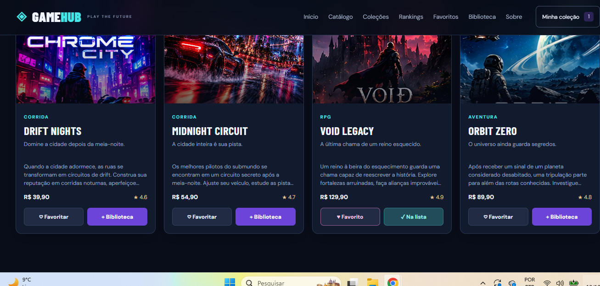
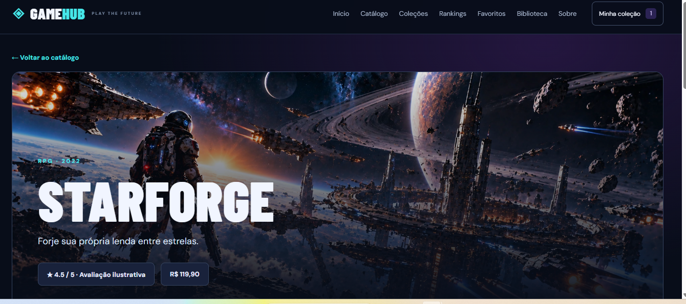

# GameHub 🎮

**GameHub** é uma plataforma demonstrativa de descoberta e organização de jogos fictícios, com identidade visual gamer, catálogo interativo e biblioteca pessoal. Desenvolvida com **HTML5, CSS3 e JavaScript puro**, sem backend.

## 🌐 Acessar o projeto

- **Site (GitHub Pages):** [Abrir GameHub](https://jefersonalvesrs.github.io/GameHub/)
- **Código-fonte:** [GitHub — GameHub](https://github.com/JefersonAlvesrs/GameHub)

> O endereço do GitHub Pages acima é o padrão para um repositório chamado `GameHub`. Confirme o endereço em **Settings → Pages** depois de ativar a publicação.

## 📸 Capturas de tela

### Catálogo de jogos


### Página de detalhes


### Interface e navegação


## ✨ Funcionalidades

- **24 jogos fictícios**, com capas locais, sinopses e páginas individuais.
- Catálogo com pesquisa, filtros por gênero e preço e ordenação.
- Página inicial com destaques, gêneros e acesso rápido ao catálogo.
- **Favoritos** salvos no navegador usando `localStorage`.
- **Biblioteca pessoal** para acompanhar os estados *Quero jogar*, *Jogando* e *Concluído*.
- Coleções temáticas, rankings e sugestões de jogos relacionados.
- Layout responsivo para desktop e dispositivos móveis.
- Sem cadastro e sem dependências de instalação.

## 🛠️ Tecnologias

**HTML5 · CSS3 · JavaScript · localStorage**

## 📁 Estrutura do projeto

```text
GameHub/
├── assets/
│   ├── art/                 # Capas locais em JPG e WebP
│   ├── screenshots/         # Imagens exibidas neste README
│   └── games.json           # Dados do catálogo
├── index.html
├── catalogo.html
├── colecoes.html
├── rankings.html
├── favoritos.html
├── biblioteca.html
├── jogo.html
├── sobre.html
├── styles.css
├── data.js
├── script.js
└── README.md
```

## ▶️ Executar localmente

Clone o repositório ou baixe os arquivos e abra `index.html` no navegador. Também é possível usar a extensão **Live Server** do VS Code.

## ⚠️ Projeto demonstrativo

Os jogos, preços, avaliações e demais informações são **fictícios**. Não há compras reais, jogos executáveis ou contas de usuário. Os dados pessoais da biblioteca e dos favoritos ficam salvos apenas no navegador. As artes foram produzidas para fins ilustrativos e podem ser aprimoradas em futuras versões.

## 👨‍💻 Desenvolvedor

**Jeferson Alves** — [GitHub](https://github.com/JefersonAlvesrs)
